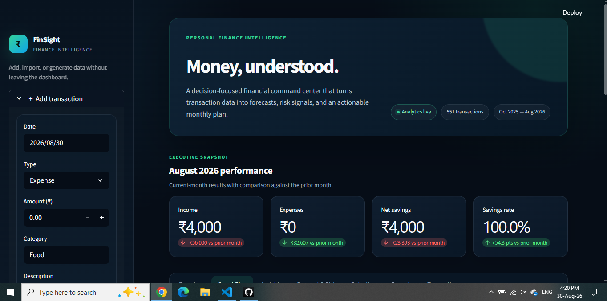
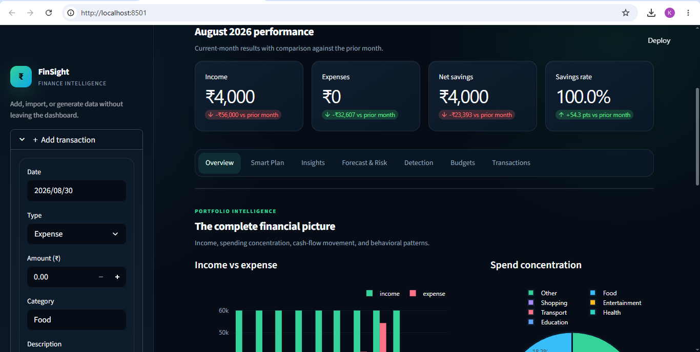

# 📈 FinSight — Intelligent Personal Finance Tracker

[](https://github.com/Kaushik-web-arch/finsight-personal-finance-intelligence/actions/workflows/tests.yml)
[](https://www.python.org/)
[](https://streamlit.io/)
[](LICENSE)

A recruiter-ready personal finance product with an Executive Fintech interface and a complete data-science pipeline.
It goes beyond CRUD: **data ingestion → feature engineering → EDA → decision support → forecasting → risk classification → anomaly detection**.

---

## 🖥️ Product preview

### Executive command center

A recruiter-facing overview of the product experience: live analytics status, monthly KPIs, savings performance, and navigation across the decision-support modules.



### Spending intelligence

The analytics workspace combines income-versus-expense trends with category concentration and behavioral signals.



> Screenshots use synthetic portfolio data; no personal financial information is included.

---

## 🎯 What this project demonstrates

| Area | Technique |
|------|-----------|
| Data handling | pandas, SQLite, CSV ingestion |
| Preprocessing | missing values, dtype coercion, dedup, normalization |
| Feature engineering | `month`, `day_of_week`, `is_weekend`, rolling stats, `expense_ratio` |
| EDA | trend, category, behavioral pattern analysis |
| Insight engine | rule-based natural-language insight generation |
| ML — Regression | Linear Regression for next-month expense forecast |
| ML — Classification | Logistic Regression for overspend prediction |
| Anomaly detection | Z-score + IQR (per category) |
| Pattern mining | Recurring expense detection (amount + interval) |
| Decision support | Savings-goal-aware safe-to-spend planner |
| Product design | Responsive Executive Fintech UI and unified chart system |
| Dashboard | Streamlit + Plotly |

---

## 🏗️ Architecture

```
User Input / CSV ──► SQLite ──► Preprocessing ──► Feature Engineering
                                       │
                          ┌────────────┼────────────┐
                          ▼            ▼            ▼
                         EDA       Insights        ML
                          │            │            │
                          └──────► Streamlit Dashboard
```

---

## 📂 Project structure

```
finance_tracker/
├── app.py                       # Streamlit dashboard (entry point)
├── .streamlit/config.toml       # Executive Fintech theme configuration
├── requirements.txt
├── README.md
├── data/
│   └── transactions.csv         # synthetic dataset (auto-generated)
├── src/
│   ├── __init__.py
│   ├── data_generator.py        # synthetic transactions w/ realistic patterns
│   ├── database.py              # SQLite layer
│   ├── preprocessing.py         # cleaning + feature engineering
│   ├── eda.py                   # EDA aggregations
│   ├── insights.py              # rule-based insight engine
│   ├── prediction.py            # linear regression forecaster
│   ├── classifier.py            # overspend classifier
│   ├── anomaly.py               # Z-score + IQR anomaly detection
│   ├── recurring.py             # recurring expense detector
│   ├── planner.py               # savings goal + safe-to-spend plan
│   └── ui.py                    # visual system and Plotly styling
├── notebooks/
    └── analysis.ipynb           # full DS report (EDA + ML + evaluation)
└── tests/
    └── test_planner.py          # Smart Plan unit tests
```

---

## 🚀 Quick start

```bash
# 1. Create a virtual environment (recommended)
python -m venv venv
source venv/bin/activate          # Windows: venv\Scripts\activate

# 2. Install dependencies
pip install -r requirements.txt

# 3. Generate synthetic data + initialize the database
python -m src.data_generator

# 4. Launch the dashboard
streamlit run app.py
```

The app opens at http://localhost:8501.

Run the automated Smart Plan checks with:

```bash
python -m unittest discover -s tests -v
```

---

## 📊 Dashboard features

- **Executive snapshot** — current income, expense, savings, and prior-month movement
- **Premium UI system** — responsive dark fintech styling, focused navigation, and consistent charts
- **Smart Plan** — set a savings goal and calculate a safe daily/monthly allowance
- **Bill reserve** — keeps detected but unpaid recurring bills out of spendable cash
- **Category guardrails** — live budget utilization with OK/watch/over status
- **Trends** — monthly + daily spending lines
- **Category breakdown** — pie + bar
- **Behavioral analysis** — weekend vs weekday, day-of-week heatmap
- **Budgets** — set per-category budget, see over-budget flags
- **🔍 Insights** — auto-generated natural-language statements
- **📈 Forecast** — next-month expense via Linear Regression
- **🚨 Anomalies** — unusually large transactions per category
- **🔄 Recurring** — auto-detected subscriptions / bills
- **🎯 Overspend classifier** — predicts if you'll go over budget this month
- **Filtered ledger** — search, filter, inspect, and export transaction subsets

---

## 🧪 Reproducing the DS report

Open `notebooks/analysis.ipynb` in Jupyter for the full academic write-up:
EDA charts, model evaluation (MAE, R², accuracy, confusion matrix), and discussion.

```bash
pip install jupyter
jupyter notebook notebooks/analysis.ipynb
```

---

## 🔬 Model scope and engineering decisions

- The included generator creates synthetic data so the public demo never exposes personal financial information.
- Forecasting compares interpretable baseline models rather than presenting a black-box model as artificial intelligence.
- Evaluation metrics are educational because the generated history is intentionally small; larger real-world datasets would require walk-forward validation and stronger holdout evaluation.
- SQLite keeps local setup simple. A multi-user production deployment should use authenticated users and a managed database such as PostgreSQL.
- The public portfolio version should use demo data or session-isolated uploads so one visitor cannot access another visitor's transactions.

---

## 🗣️ How to present this project

> *"I built FinSight, a decision-focused personal finance product that transforms raw transactions into behavioral insights, a safe-to-spend monthly plan, model-selected expense forecasts, overspending risk, and statistical anomaly alerts. I also designed a reusable Executive Fintech UI system in Streamlit and Plotly."*

---

## 📝 License
MIT — use freely for academic submission.
